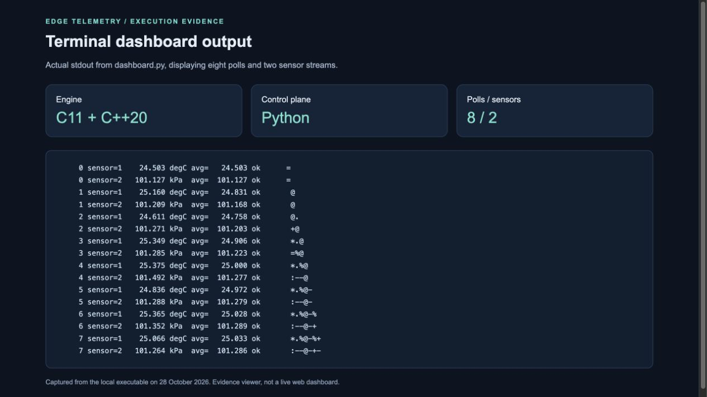
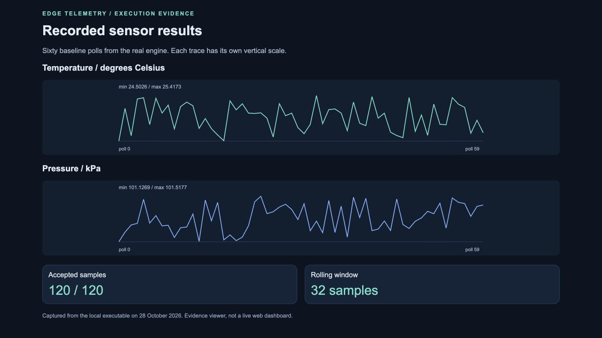
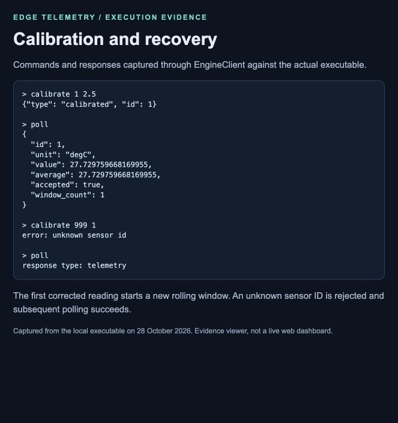
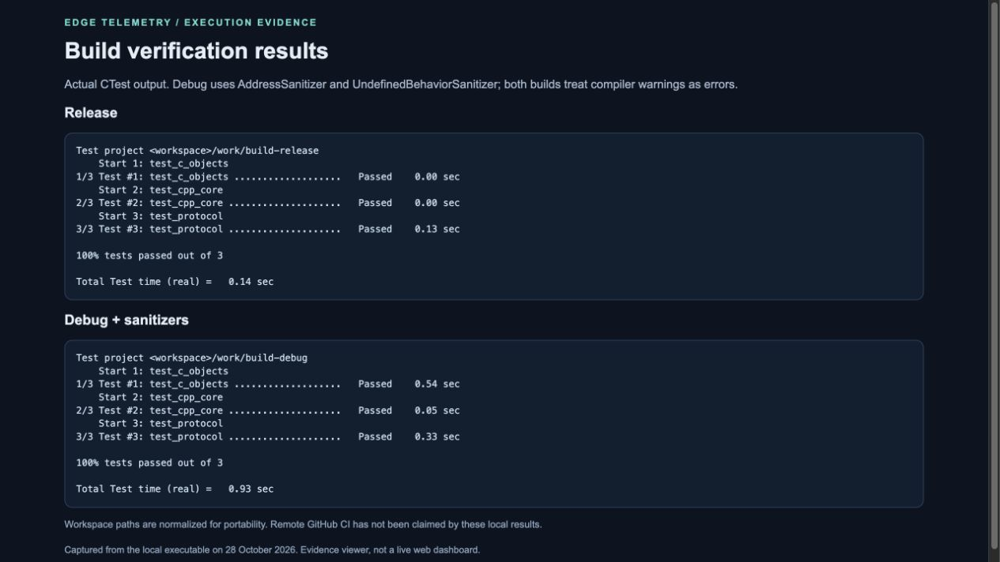

# Hybrid-Paradigm Edge IoT Sensor Simulation & Telemetry Engine


## Hybrid-Paradigm Edge IoT Sensor Simulation & Telemetry Engine

TECHNICAL DESIGN AND EXECUTION REPORT

C11 manual polymorphism | C++20 aggregation | Python control plane

Repository owner: dhruv-thecloud

Repository name: edge-telemetry-engine

Repository: https://github.com/dhruv-thecloud/edge-telemetry-engine

Prepared: 28 October 2026

This project implements a working local telemetry simulator across C11, C++20,
and Python. Its purpose is to demonstrate explicit ownership and substitutable
sensor implementations across language boundaries while keeping the control
plane separate from sampling and aggregation. Two built-in sensors generate
repeatable readings. A C++ manager filters anomalies and maintains rolling
statistics. A Python process drives acquisition, shows trends, logs frames, and
sends calibration commands.

The implementation is suitable as an extensible simulation foundation. It is
not a hardware driver, a network service, or a certified hard real-time system.
Performance-oriented design choices are described below; workload-specific
throughput and latency have not been benchmarked.

This report documents the implemented source code and a reproducible local execution. Four screenshots show actual captured readings, calibration behavior, dashboard output and test results in an evidence viewer. The viewer is a static presentation of recorded results; it is not a deployed or live web application.

Report guide: architecture (2); C objects (3); C++ ownership (4); filtering (5); protocol (6); Python dashboard (7); SOLID (8); build and reproduction (9); sensor results (10); calibration results (11); test evidence (12); performance (13); delivery and limitations (14).


## 02 / System architecture and requirements

| Layer | Responsibility | Boundary |
|---|---|---|
| Python dashboard | Schedule polls, present values, log frames | Child-process stdin/stdout |
| C++ protocol loop | Parse commands and emit JSON | Aggregator method calls |
| C++ aggregator | Own sensors, filter samples, retain statistics | C Sensor API |
| C concrete sensors | Simulate readings and correction | Struct + function-pointer vtable |

There is one engine process and one Python controller. The engine is synchronous:
a command is parsed and completed before the next command is handled. Each poll
reads both sensors, updates their histories, and emits a complete telemetry frame.
This serial ordering prevents a calibration from racing with an acquisition.
The Python client has a reader thread solely to provide response timeouts on
portable subprocess pipes. The dashboard optionally has a daemon console-reader
thread; engine requests remain on the dashboard's main thread.

The design supports two interchangeable sensor implementations, deterministic seed-driven readings, numeric validation, controlled calibration, and bounded rolling history. It deliberately keeps the transport outside the C layer: a device driver never needs to know whether values are shown in a terminal, saved to disk, or processed by another program.

The principal invariants are single ownership, complete vtables, unique sensor IDs inside a manager, finite accepted values, and one outstanding protocol request. These invariants make reasoning about lifetime and response ordering substantially simpler than a design with shared mutable objects and concurrent control commands.

The process boundary also isolates presentation dependencies. A Python logging failure can terminate the controller without changing how a C sensor is represented. The client closes its child process on normal exit and handled errors. Conversely, a recoverable invalid calibration request yields an error response and leaves the engine available for another command.


## 03 / C sensor interface and object layout

`Sensor` is an abstract convention enforced by its API contract rather than by a
language keyword. It holds identity, units, and a pointer to a `SensorVTable`.
The table supplies `read`, `calibrate`, and `destroy` callbacks. Public dispatch
functions call through that table without branching on concrete sensor type.

`TemperatureSensor` and `PressureSensor` embed the base as their first member.
C's initial-member layout rule supports conversion between the base pointer and
the enclosing concrete object. Static assertions record the layout requirement.
Their concrete structs and simulation internals are private to `c_sensor.c`;
the public base supports third-party implementations. Exposing the base means
encapsulation is contractual, not protection against malicious memory mutation.

Constructors validate parameters before allocation, initialize the full object,
and transfer a single owning pointer on success. Failure leaves the output slot
null. The caller must pass an empty output slot to avoid losing an existing
allocation. Virtual destructors free the complete concrete object. Future driver
implementations can also release device handles or buffers in those callbacks.

Simulation uses per-object xorshift32 state and a bounded additive noise model:

`reading = nominal + amplitude * normalized_noise + calibration_offset`

Calibration replaces the absolute offset; repeated calibration to the same value
does not accumulate correction. Non-finite and unsafe numeric inputs are rejected
with status codes. Read failure leaves the output unchanged. Objects are mutable
and are not internally synchronized. Each thread may own an independent sensor;
sharing requires external serialization.

Manual vtables do not eliminate virtual dispatch overhead: each call still uses
an indirect function pointer, much like typical C++ virtual dispatch. Their value
here is an explicit C ABI and layout suitable for C drivers, not an unmeasured
speed advantage over C++.

Representative public contract:

```c
typedef struct SensorVTable {
    SensorStatus (*read)(Sensor*, double*);
    SensorStatus (*calibrate)(Sensor*, double);
    void (*destroy)(Sensor*);
} SensorVTable;
```

The base is the first member of each concrete object, followed by private simulation state. Each sensor type installs its own static table. The manager can therefore call sensor_read without inspecting a type tag. A new implementation can keep the same contract while replacing the simulator with a real driver.


## 04 / C++ ownership and aggregation

`SensorPtr` uses a stateless custom deleter that invokes `sensor_destroy`.
`std::unique_ptr` therefore pairs C allocation with the correct virtual C cleanup,
including during exception unwinding. `std::shared_ptr` is deliberately unnecessary:
the aggregator is the sole owner, and consumers receive value snapshots.

`Aggregator::add` accepts ownership by value. Duplicate IDs or invalid thresholds
raise `std::invalid_argument`, and the rejected input is still destroyed. The
manager stores entries in `std::vector`; each contains the sensor, its unit-aware
threshold, and a `RollingWindow<32>`. The rolling-window template uses a fixed-size
array and modular indexing, so updating the window requires no allocation.

`poll()` validates sensor results, applies the anomaly policy, updates accepted
histories, and returns telemetry snapshots. The returned vector reserves space
for all sensors. Sensor read failures raise `std::runtime_error`; this aborts the
frame. Earlier sensors in that poll may already have advanced their PRNG and
history: polling is intentionally not a transactional operation with rollback.

Calibration locates a sensor by ID, calls its virtual callback, and clears its
history only after success. Unknown IDs and rejected offsets raise exceptions.
The protocol boundary converts recoverable command exceptions to error frames.
Fatal initialization failures go to stderr and return a nonzero exit status.

```cpp
struct SensorDeleter {
    void operator()(Sensor* p) const noexcept {
        sensor_destroy(p);
    }
};
using SensorPtr = std::unique_ptr<Sensor, SensorDeleter>;
```

The lifetime path is constructor -> owning SensorPtr -> aggregator entry -> virtual destructor. There is no manual free at a C++ call site. Returning snapshots avoids exposing mutable sensor internals, though the unit string in a snapshot remains borrowed from the sensor and must not outlive its owner.


## 05 / Rolling statistics and anomaly decisions

The filter accepts the first eight samples as warm-up. For each later reading,
it compares the value against the mean and population standard deviation of
previously accepted readings. Acceptance is inclusive at:

`abs(value - mean) <= max(absolute_threshold, sigma_multiplier * deviation)`

The default multiplier is four; the absolute floors differ by sensor units.
A nonzero floor prevents a zero-variance history from rejecting every small
change. Rejected samples remain visible in telemetry but do not affect the
average. The rolling window retains up to 32 accepted samples, not 32 elapsed
time intervals. Statistics are recomputed from the bounded window to avoid
accumulated cancellation from repeatedly subtracting squared values.

Warm-up can accept outliers, and sustained shifts can be rejected indefinitely.
For a hardware deployment, baseline initialization, adaptation, hysteresis, and
sensor-specific physical constraints should be chosen from measured noise and
failure modes. Calibration deliberately resets the baseline to accommodate a
known correction. The test suite demonstrates a 1000-unit injected spike against
a stable 10-unit baseline and verifies that the reported average stays at 10.

| Situation | Decision | History effect |
|---|---|---|
| Fewer than eight prior accepted values | Accept finite reading | Add to warm-up history |
| Reading inside threshold | Accept | Insert and evict oldest if full |
| Reading outside threshold | Reject as anomaly | Preserve prior history |
| Successful calibration | Start new baseline | Clear history |
| Failed read | Abort frame with error | Earlier entries may already have advanced |

For a stable baseline of 10 with zero deviation and an absolute floor of 1, the permitted interval is [9, 11]. The scripted test supplies eight baseline readings followed by 1000. That spike is rejected and the average remains 10. A later normal reading is accepted again. This demonstrates a deliberate anomaly; the bounded default simulator normally remains within the configured thresholds.

The detector is a heuristic, not a calibrated probability estimate. A four-sigma multiplier does not establish a false-positive rate when the sample distribution, warm-up quality and independence assumptions are unknown.


## 06 / Command protocol and failure behavior

The executable accepts a small line-oriented command language and returns JSON lines. Each request is processed synchronously. The controller can correlate a reply by ordering because it never has more than one outstanding request. A future multiplexed service would require request identifiers and explicit schema versioning.

| Input | Response type | Meaning |
|---|---|---|
| poll | telemetry | One sample per registered sensor |
| calibrate ID OFFSET | calibrated | Correction accepted; history cleared |
| quit | bye | Clean shutdown |
| Malformed or invalid command | error | Human-readable message; engine continues |

```json
{"type":"calibrated","id":1}
{"type":"error","message":"unknown sensor id"}
```

A telemetry object contains sequence, elapsed_ms and samples. Each sample contains id, unit, value, average, accepted and window_count. Sequence starts at zero for each engine process. The monotonic elapsed time is measured from engine initialization and is not a UTC timestamp. Rejected readings remain visible through value and accepted=false, while average continues to describe accepted readings only.

Commands are bounded to 4096 bytes excluding the newline. Oversized lines are drained before the engine rejects them, preventing a trailing fragment from becoming an unintended second command. Unexpected extra tokens are rejected. IDs are parsed as unsigned 32-bit decimal values. Non-finite offsets, unknown IDs and unsafe calibration ranges produce errors.

The program processes a final unterminated line when stdin reaches EOF, then shuts down. Startup errors go to stderr; protocol replies go to stdout. JSON strings are escaped to prevent control characters from corrupting framing. Every response is flushed immediately so the Python reader does not wait for a large stdio buffer to fill.

The client defaults to a five-second response timeout. It discards a timed-out connection rather than guessing which later response belongs to which command. These rules address local process communication; they do not provide authentication, encryption, network replay protection or durable delivery.


## 07 / Python dashboard and acquisition workflow

The Python controller launches the engine without a shell and owns its lifetime through a context manager. A reader thread places replies into a queue, allowing the request method to impose a timeout. The dashboard's main thread schedules polls and sends commands; an optional console-reader thread only queues operator input.

The displayed fields are sequence, sensor ID, raw reading, unit, rolling average and acceptance flag. A 40-reading ASCII sparkline shows the recent shape of each signal. Its minimum and maximum are scaled independently, so two similarly shaped traces do not imply equal amplitudes.

At normal exit or Ctrl-C, the controller requests quit and reaps the child. If the engine does not exit within the shutdown timeout, cleanup escalates to terminate and then kill. Optional JSONL logging appends and flushes each telemetry frame. It does not log every calibration command and should not be treated as a complete audit trail.

The screenshot below displays eight real polls produced by dashboard.py. It is a browser rendering of the captured terminal stdout so the result can be read clearly in a report. The underlying text is included in docs/evidence/dashboard.txt.





## 08 / SOLID and extension design

| Principle | Concrete application | Boundary or limitation |
|---|---|---|
| Single responsibility | C simulates devices; Aggregator owns/filter samples; main handles protocol; Python handles presentation | The aggregator combines ownership with its closely related filtering policy |
| Open/closed | New sensor types install another vtable and register with `add()` | The built-in executable still needs composition code to instantiate a new sensor |
| Liskov substitution | Both sensors obey the same read, calibration, and destruction contract | Status, units, and failure-state rules must be preserved by extensions |
| Interface segregation | A compact three-operation sensor interface avoids presentation or transport dependencies | Read-only hardware would need a split capability interface or an explicit unsupported status |
| Dependency inversion | Aggregator depends on the C sensor contract rather than concrete types | Construction remains in the executable's composition root |

The main patterns are manual virtual dispatch, factory-style construction,
RAII ownership, composition, and a request/response protocol. The scripted sensor
in `test_cpp_core.cpp` demonstrates extension outside the built-in implementations:
it plugs into the same manager without modifying aggregation logic.

Extension example: the scripted sensor in test_cpp_core.cpp embeds a Sensor base and installs a separate table. Its read callback emits a stable value, an injected spike and later corrected values. The same Aggregator consumes it without a type-specific branch. Its destructor increments a counter, allowing the test to verify cleanup both on duplicate-ID rejection and normal scope exit.

This extension makes the substitution boundary executable rather than purely diagrammatic. A future humidity sensor would follow the same construction and callback rules, expose its own unit string, and be registered with an appropriate absolute anomaly threshold. Changing the filter algorithm itself is currently a manager change; a pluggable filter policy would be a separate future extension.


## 09 / Build and reproducibility

CMake compiles the sensor implementation as C11, the manager and executable as
C++20, and links separate static libraries into one executable. `extern "C"`
guards preserve C symbol names when included from C++. Warnings and sanitizers
are target-scoped. Tests can be omitted with `-DBUILD_TESTING=OFF`; otherwise
Python 3.10+ is required for integration checks.

C tests compiled as C++ consumers verify the ABI-facing interface, invalid-input
handling, calibration semantics, and deterministic sampling. Manager tests check
rolling-window eviction, polymorphic injected samples, ownership cleanup,
rejected duplicate IDs, and baseline resets. Integration tests launch the real
engine and dashboard, verifying malformed-command recovery, length limits, EOF,
calibration, and logged telemetry. Checks do not rely on `assert`, so Release
builds retain them. CI supplies Linux and macOS sanitizer runs. CI results are
available only after pushing and running the workflow; configuration alone is
not evidence that a remote run passed.

The GitHub helper accepts an explicit repository URL, validates branch and remote
state, stages the documented project paths, commits changes, and performs an
ordinary push. It does not force changes over remote history or silently rename
branches. Authentication and creation of the destination repository remain user
setup steps. No deployment is performed by building or testing the project.

```sh
cmake -S . -B build -DCMAKE_BUILD_TYPE=Release
cmake --build build --parallel
ctest --test-dir build --output-on-failure
python3 python/dashboard.py --engine build/edge_telemetry
```

```sh
cmake -S . -B build-sanitize -DCMAKE_BUILD_TYPE=Debug \
  -DEDGE_SANITIZERS=ON -DEDGE_WARNINGS_AS_ERRORS=ON
cmake --build build-sanitize --parallel
ctest --test-dir build-sanitize --output-on-failure
```

Local evidence was obtained on macOS arm64 with Apple Clang 17 and Python 3.12. The repository includes the CMake project and raw result files so another developer can reproduce functional behavior. Test durations depend on the host and are not throughput measurements.


## 10 / Recorded telemetry results

A controlled run collected sixty baseline polls from a fresh engine. This produced 120 sensor readings. All were accepted, consistent with the simulator's narrow bounded noise and the larger configured anomaly floors. The raw frame sequence is retained in docs/evidence/telemetry.json.

| Sensor | Observed minimum | Observed maximum | Unit |
|---|---|---|---|
| Temperature | 24.502644 | 25.417269 | degC |
| Pressure | 101.126939 | 101.517698 | kPa |

These are sample extrema for this captured run, not limits guaranteed by physical hardware. The chart uses poll index on the horizontal axis and independent vertical scaling for the two signals. The collection loop ran without a fixed sampling interval, so the plot should not be interpreted as elapsed-time frequency analysis.





## 11 / Calibration and command recovery

After the sixty baseline polls, the controller sent calibrate 1 2.5. This sets an absolute +2.5 degree Celsius correction; it does not accumulate another correction on each repeat. The engine acknowledged the operation, and the next temperature sample was 27.729760 degrees Celsius.

The next sample's window_count was one and its average equaled its raw value, confirming that successful calibration started a new baseline. Ten corrected polls were captured. A subsequent calibration request for sensor 999 was rejected as an unknown sensor ID, and the next poll still returned telemetry.

The demonstration proves successful correction, baseline reset and recovery after a command error. It does not establish calibration accuracy against a reference instrument because both sensors are simulated. Pressure calibration uses the same additive contract in kPa.





## 12 / Validation results and coverage

Both the Release build and the Debug build with AddressSanitizer and UndefinedBehaviorSanitizer passed all three CTest targets. The protocol target runs Python integration checks against the actual executable and dashboard. These are local results, distinct from a future GitHub Actions run.

The C target checks deterministic seeds, invalid values, calibration semantics and destruction. The C++ target checks window eviction, injected-spike rejection, baseline reset and ownership cleanup. Integration checks exercise malformed commands, oversized lines, EOF, recovery and dashboard logging.

No sanitizer finding was reported by these runs. Passing tests are evidence for the covered cases; they do not prove the absence of all memory errors or establish real-time performance. Allocation-failure injection, extended concurrency testing and hardware fault coverage remain outside this suite.





## 13 / Performance and engineering tradeoffs

For S sensors and a fixed window W=32, each poll costs O(S * W) for statistics,
O(S) result storage, and O(S) JSON serialization. Sensor sampling and history
updates do not allocate. Each poll allocates its result vector; parsing and JSON
I/O can allocate and block. Registration can reallocate the entry vector. The
engine has no per-sensor worker threads, lock contention, or network stack.

`long double` arithmetic and hypot-based deviation avoid common overflow from
squaring values, but floating-point precision and extreme-range behavior remain
platform-dependent. `long double` may have the same range as `double`. Normal
sensor magnitudes are the intended operating range. Compiler fast-math options
are incompatible with the finite-value validation contract.

Before optimizing, benchmark sensor counts, polling intervals, window sizes,
serialization cost, and slow-consumer behavior. Potential measured improvements
include reusing frame buffers, binary transport, batched acquisition, and
carefully stabilized incremental statistics. None is claimed necessary or faster
without workload evidence.

| Resource | Current behavior | Engineering consequence |
|---|---|---|
| C read path | Constant-size state; no heap allocation | Predictable per-read work |
| Rolling history | Fixed 32-value array per sensor | Bounded retained memory |
| Frame construction | One reserved vector per poll | Allocation remains in the C++ path |
| Statistics | Recomputed across a short window | Simple numerical behavior; O(S * W) |
| Output | JSON serialization and synchronous flushing | Consumer speed can limit throughput |
| Logging | Append and flush every frame | Durability/latency tradeoff; no rotation |

A useful next benchmark would vary sensor count and poll rate while recording median and tail response latency, CPU utilization, allocations per frame and dropped deadlines. The current recorded sample set is functional evidence only. Claiming a throughput figure from CTest's total runtime would conflate test harness work with engine sampling performance.


## 14 / Delivery, limitations and source map

This version has no network authentication, persistence of calibration across
restarts, hot-plug discovery, retries for device faults, or hardware clock
synchronization. Stdin/stdout is local process transport; calling a calibration
command "remote" does not imply a secured network control plane. The response
schema has no version negotiation or request IDs because there is one outstanding
request; multi-client transport would need both.

Further engineering should add measured performance budgets, driver-specific
fault handling, calibration audit records, log rotation, and protocol versioning
before deployment outside this local simulation setting. The current code makes
those boundaries explicit and provides tests for the implemented behavior.

GitHub identity: dhruv-thecloud

Repository: https://github.com/dhruv-thecloud/edge-telemetry-engine

The source distribution includes the C/C++ code, Python controller, CMake configuration, test suite, CI workflow, technical documentation and recorded execution evidence. The PDF is intended to accompany the implementation rather than replace its build instructions. No student registration number, institutional affiliation or personal contribution history has been invented.

| Topic | Primary project source |
|---|---|
| Base sensor contract and constructors | include/c_sensor.h; src/c_sensor.c |
| Ownership, rolling window and filtering | include/cpp_aggregator.hpp; src/cpp_aggregator.cpp |
| Protocol framing and dispatch | src/main.cpp |
| Process lifetime and dashboard | python/simulator_client.py; python/dashboard.py |
| Validation | tests/test_c_objects.cpp; tests/test_cpp_core.cpp; tests/test_protocol.py |
| Captured results | docs/evidence/*.txt; telemetry.json; PNG screenshots |

Evidence provenance: all screenshots were captured from local browser pages rendering output from the supplied executable. The pages are explicitly labelled as an evidence viewer. Claims in this report are based on the implementation and captured local tests; no deployed website, hardware measurement or remote CI success is implied.
